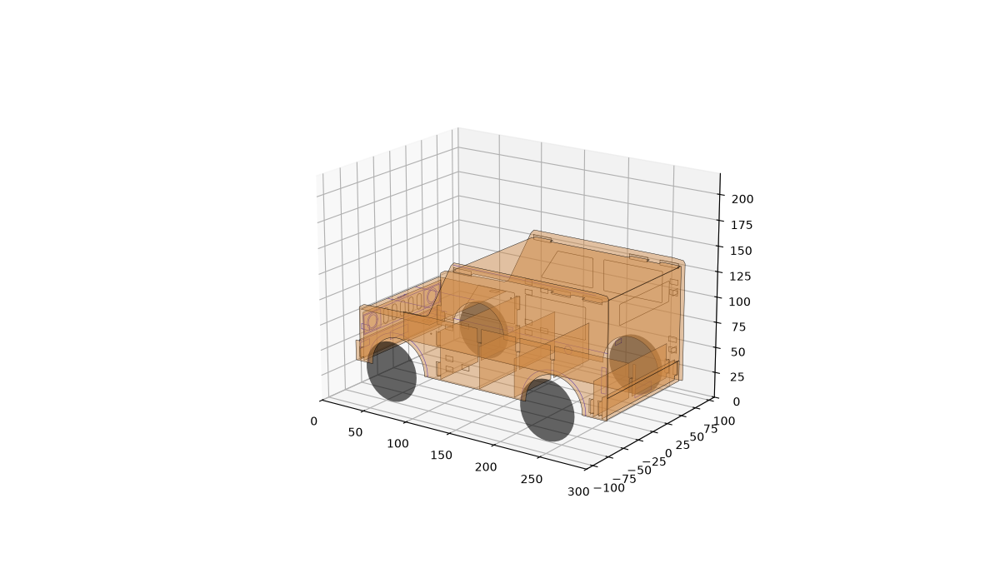
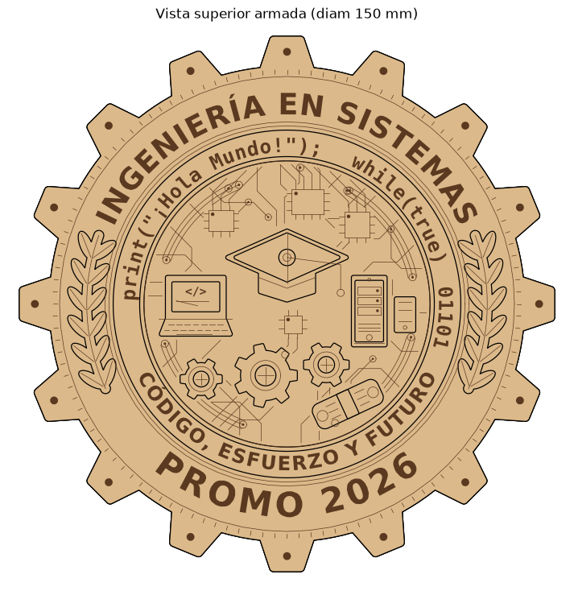
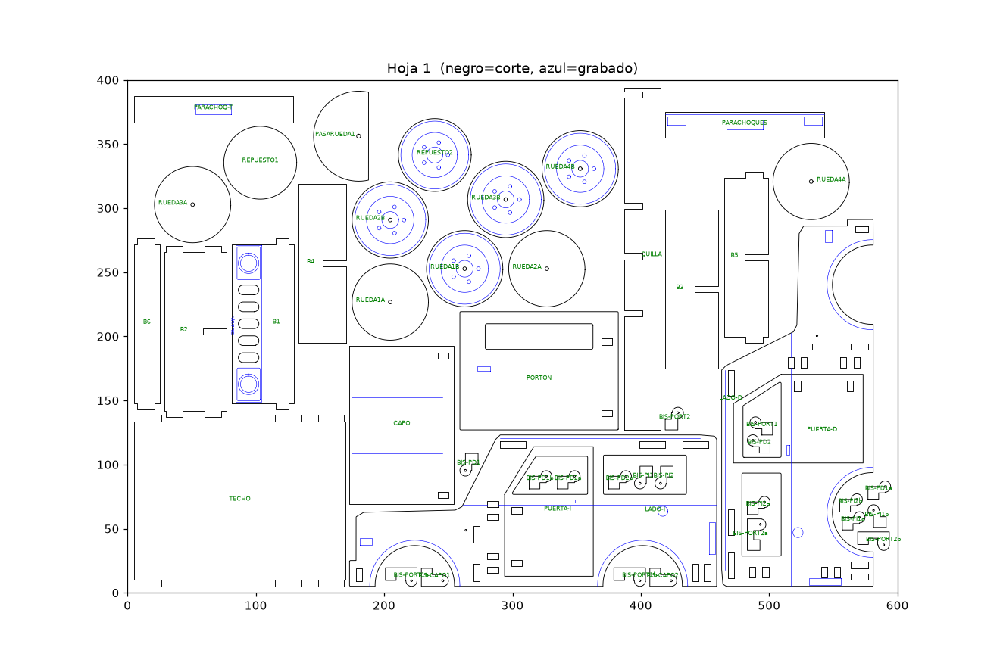

# Generadores paramétricos para corte láser (MDF)

Scripts en Python que generan **piezas listas para cortar en láser** (DXF con capas de corte, grabado y etiquetas, más vistas previas en PNG). Todo es **geometría paramétrica**: si cambias el espesor del material, el kerf o el tamaño, las ranuras, lengüetas, bisagras y ejes se recalculan, en vez de escalar el dibujo.

| Suzuki Samurai SJ413 armable | Placa "Ingeniería en Sistemas" por capas |
|---|---|
|  |  |

## Scripts
| Script | Qué genera |
|---|---|
| `samurai_caja.py` | Maqueta del Suzuki Samurai a partir de las medidas del plano: costados con ventanas, costillas con lengüetas, techo, capó y quilla a media madera. **Piezas móviles**: puertas, capó y portón con bisagras de nudillo, y ruedas sobre ejes. Parámetros: `--esp`, `--largo`, `--kerf`, `--ranura`, `--eje`, `--pasador`. |
| `placa.py` | Placa conmemorativa de 5 capas (engranaje, laureles, textos en arco, iconos), con hoja de corte y vista armada. |
| `coupon.py` | **Peine de calibración de kerf** (ranuras de 4,7 a 5,3 mm) para medir el ajuste real del láser y el material. |
| `slicer.py` | Corta un modelo 3D (OBJ/STL) en placas cruzadas X/Y con ranuras a media altura (voxelización + contornos). |

Cada generador hace sus **chequeos** (piezas que caben en la cama, lengüetas con dónde apoyarse, holguras mínimas) antes de escribir los archivos.

## Uso
```bash
pip install -r requirements.txt
python coupon.py 5                       # peine para MDF de 5 mm → cortar y medir
python samurai_caja.py --esp 5 --largo 300 --kerf 0.15 --out salida/
python placa.py --diam 150 --esp 5 --out salida/
```
Abre los DXF en RDWorks, LightBurn o Inkscape: capa **CORTE** (rojo) y **GRABAR** (azul).



**Tecnologías:** Python, Shapely (geometría 2D), ezdxf (DXF por capas), NumPy, Matplotlib (vistas y texto vectorial), trimesh/SciPy (slicer).
